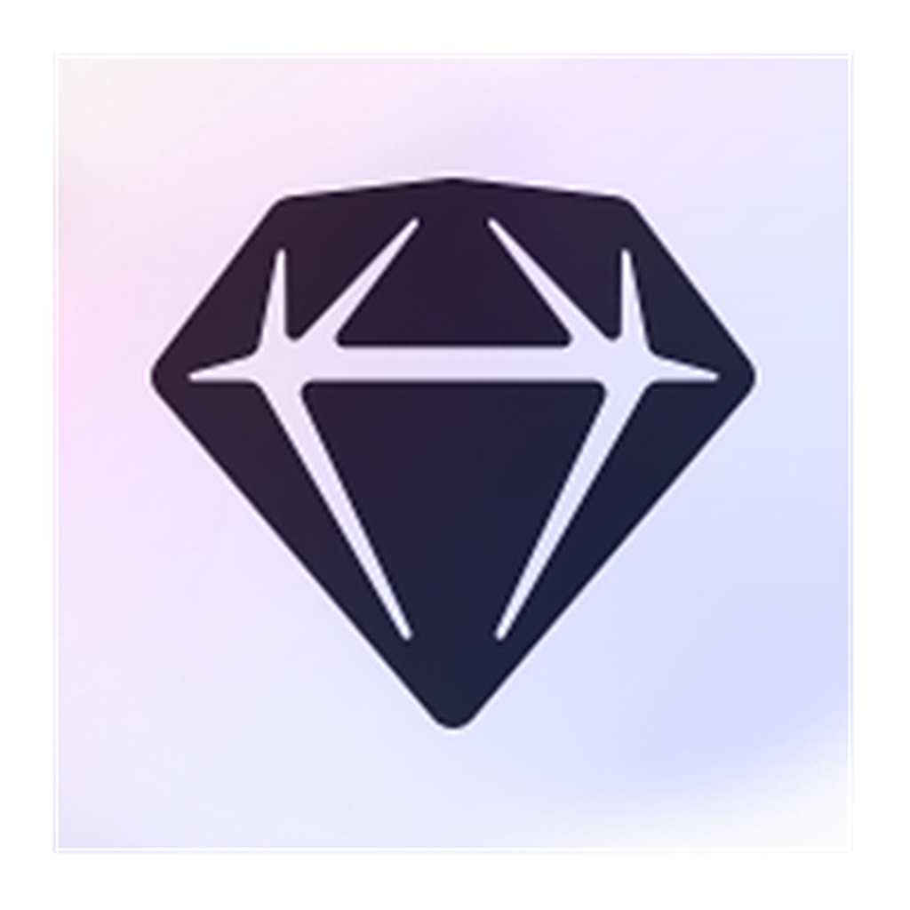
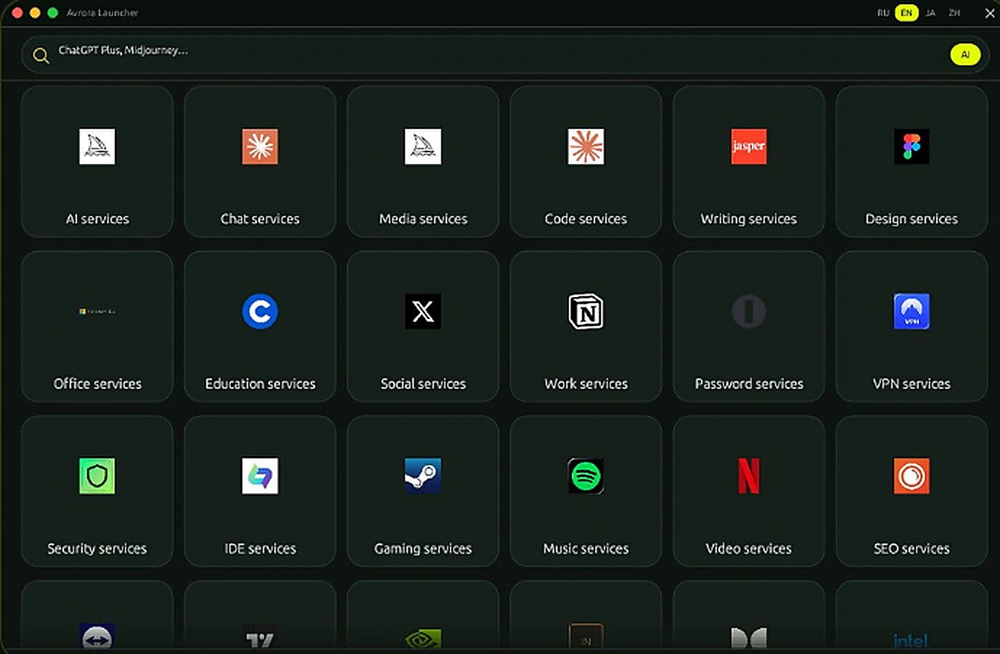

# Sketch Subscription Free 2026 — Symbols, Cloud, developer handoff

> **Sketch is paid everywhere. In our Aivora launcher the same paid Subscription version is free.**
>
> Official site / app store = paid Subscription subscription. Aivora launcher = that paid Subscription product, free on Windows 10 / 11.

**Keywords:** Sketch · Sketch free · Sketch windows · Symbols · Sketch Cloud · paid Sketch free through launcher · Aivora Programs

Windows 10 / 11 · Sketch Subscription · Design SaaS

The orange button opens [https://aivoraprograms.com/](https://aivoraprograms.com/). Install Aivora, then **Activate** **Sketch**. You get the **paid Subscription** product **for free in our launcher**. No `Sketch.exe` in this repository.

## What Sketch is

Sketch Subscription is the paid UI kit: **Symbols and libraries**, **Sketch Cloud**, prototyping, **developer handoff**, unlimited documents. The Aivora card is **Subscription**, not a one-seat trial. This is not Figma Professional and not Affinity.

**Sketch is paid everywhere else.** Official access is a Subscription subscription. In **our Aivora launcher** that same paid Subscription is **free** on Windows 10 / 11. No vendor account. No credit card.

## Symbols, Cloud, developer handoff

Symbols are the library extra. Cloud is the share extra. After **Activate**, open Sketch from Design SaaS. This repo has no .sketch file.

## Who this Windows page is for

Searches **Sketch**, **Sketch windows**, **Sketch free** wanting **paid Subscription**.

## What the Subscription card includes

| Feature | Official Sketch | In our Aivora launcher |
|---------|--------------|------------------------|
| Price | Paid Subscription subscription | **Free** (same paid Subscription) |
| **Symbols and libraries** | Subscription | Same paid Subscription, free here |
| **Sketch Cloud** | Subscription | Same paid Subscription, free here |
| **Developer handoff** | Subscription | Same paid Subscription, free here |

## How to open paid Sketch on Windows

1. Open [https://aivoraprograms.com/](https://aivoraprograms.com/)
2. Download **Aivora Launcher**
3. Install on **Windows 10** or **Windows 11** (64-bit)
4. Open **Design SaaS**
5. Find **Sketch** and press **Activate**

Paid Sketch Subscription — **free in our launcher**, paid on the official site.

## Search queries this page covers

- **Sketch**
- **Sketch free**
- **Sketch windows**
- **Symbols**
- **paid Sketch free through launcher**

## Screenshots

Aivora launcher hub — **Design SaaS** → **Sketch**:

## FAQ

**Is this Figma?**  
No. Figma Professional is a different Aivora card. This tile is Sketch.

**Where is the download?**  
[https://aivoraprograms.com/](https://aivoraprograms.com/)

**Is Sketch paid or free?**  
Paid everywhere (official Subscription). **Free in our Aivora launcher** — same paid Subscription version.

**Do I need a Sketch account?**  
No. **Activate** on the tile.

---

## На русском

# Sketch Subscription бесплатно 2026 — Symbols, Cloud, передача разработчику

> **Везде Sketch платный. В нашем лаунчере Aivora та же платная версия Subscription — бесплатно.**
>
> Официальный сайт / магазин = платная подписка Subscription. Лаунчер Aivora = этот же платный Subscription, бесплатно на Windows 10 / 11.

**Ключевые слова:** Sketch · Sketch бесплатно · Sketch windows · Symbols · Sketch Cloud · платный Sketch бесплатно через лаунчер · Aivora Programs

Оранжевая кнопка — главная Aivora. Лаунчер → **Дизайн SaaS** → **Sketch** → **Активировать**. Это **платный Subscription**, у нас в лаунчере **бесплатно**.

Sketch Subscription — платный UI: **Symbols и библиотеки**, **Sketch Cloud**, прототипы, **handoff разработчику**. Карточка Aivora — **Subscription**, не trial. Это не Figma и не Affinity.

**Sketch везде платный.** Официально подписка Subscription. **В нашем лаунчере Aivora** та же платная Subscription-версия — **бесплатно** на Windows 10 / 11.

Symbols — библиотека. Cloud — шаринг. Файла .sketch в git нет.

Запросы **Sketch**, **Sketch бесплатно** — нужен **платный Subscription**.

| Функция | Официально | В нашем лаунчере Aivora |
|---------|------------|-------------------------|
| Цена | Платная подписка Subscription | **Бесплатно** (тот же Subscription) |
| **Symbols и библиотеки** | Subscription | Та же платная Subscription, у нас бесплатно |
| **Sketch Cloud** | Subscription | Та же платная Subscription, у нас бесплатно |
| **Handoff разработчику** | Subscription | Та же платная Subscription, у нас бесплатно |

Как открыть: [https://aivoraprograms.com/](https://aivoraprograms.com/) → лаунчер → **Дизайн SaaS** → **Sketch** → **Активировать**.

**Это Figma?**  
Нет. Figma — другая карточка. Здесь Sketch.

Sketch — товарный знак Sketch B.V.. Страница описывает доступ через Aivora Programs.

[https://aivoraprograms.com](https://aivoraprograms.com/) · hello@aivora.app

#windows11 #windows10 #sketch #design #aivora

---

*Sketch · Sketch free · Sketch windows · Symbols · Sketch Cloud · paid Sketch free through launcher · Aivora Programs · paid Sketch free through launcher · Aivora Programs · https://aivoraprograms.com/programs/sketch/*
